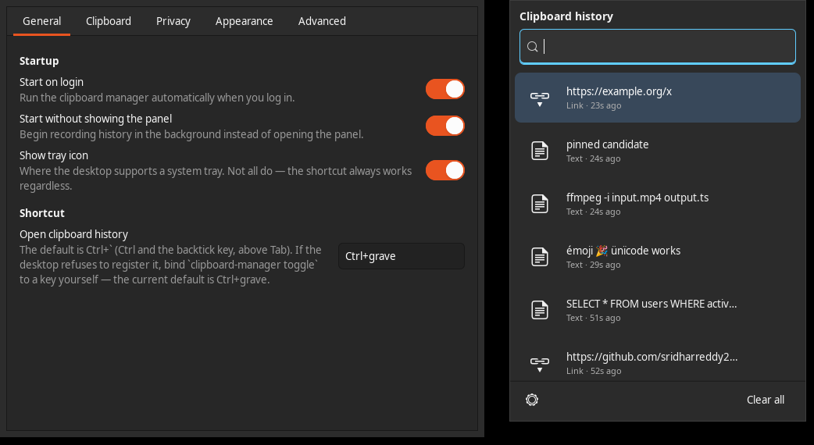

# Clipboard Manager

A clipboard history manager for Linux desktops, built to feel like the
Windows 10/11 clipboard flyout.

Press <kbd>Ctrl</kbd> + <kbd>`</kbd> and a compact panel appears next to your
pointer. Type to filter, press <kbd>Return</kbd>, and the entry is back on your
clipboard ready to paste.

Native Rust and GTK3. No Electron, no web view, no network code.

---

## Contents

1. [The shortcut](#1-the-shortcut)
2. [What it does](#2-what-it-does)
3. [Screenshots](#3-screenshots)
4. [Requirements](#4-requirements)
5. [Installation](#5-installation)
6. [First run](#6-first-run)
7. [Using it](#7-using-it)
8. [Keyboard reference](#8-keyboard-reference)
9. [Command line](#9-command-line)
10. [Settings](#10-settings)
11. [Privacy](#11-privacy)
12. [Security](#12-security)
13. [X11 and Wayland](#13-x11-and-wayland)
14. [Desktop environments](#14-desktop-environments)
15. [Where your data lives](#15-where-your-data-lives)
16. [Backup, export and import](#16-backup-export-and-import)
17. [Troubleshooting](#17-troubleshooting)
18. [Known limitations](#18-known-limitations)
19. [Building from source](#19-building-from-source)
20. [Architecture](#20-architecture)
21. [Licence](#21-licence)

---

## 1. The shortcut

**The default shortcut is <kbd>Ctrl</kbd> + <kbd>`</kbd>** — Ctrl together with
the backtick / grave-accent key, the one directly above <kbd>Tab</kbd> on a US
layout.

It is **not** <kbd>Super</kbd>+<kbd>V</kbd> and **not**
<kbd>Ctrl</kbd>+<kbd>Shift</kbd>+<kbd>`</kbd>.

You can change it in **Settings → General**. It is stored by key *name*
(`Ctrl+grave`), not by the character the key produces, so it stays on the same
physical key whatever your keyboard layout is.

If your desktop will not let the application claim the key, bind this command
to whatever key you like, in your own keyboard settings:

```
clipboard-manager toggle
```

Check whether it registered:

```
$ clipboard-manager status
  shortcut:  Ctrl + ` (backtick) — grabbed directly from the X server
```

If it did not, that line says so explicitly and `status` exits non-zero. The
application never pretends a shortcut works when it does not.

---

## 2. What it does

- Records **text**, **multi-line text**, **URLs**, **images** and **file
  selections**.
- **Instant search** — fuzzy, case-insensitive and accent-insensitive. Stays
  fast on a history of a hundred thousand entries.
- **Pinning** that survives cleanup, restart and reboot. Pinned entries never
  expire and are never removed by "Clear all".
- **Per-entry actions**: paste to clipboard, copy, pin, edit, view full
  content, delete.
- **Editable text entries** — change an entry and copy the result.
- **Thumbnails** for images, decoded at thumbnail size so a 24-megapixel
  screenshot does not cost 100 MB of memory.
- **Duplicate collapsing** — copying the same thing twice moves the existing
  entry to the top instead of adding a second copy.
- **Light, dark and system** themes, following your desktop's preference.
- Configurable history size (50 → unlimited) and retention (never → 90 days).
- Works entirely **offline**.

Monitoring is **event-driven**. There is no polling loop anywhere: on X11 it
uses XFIXES selection notifications, on Wayland the `wlr-data-control`
protocol. Idle cost is zero CPU.

---

## 3. Screenshots

The panel, and the settings window, on a dark desktop:



The panel opens next to the pointer, floats above other windows, and closes
when it loses focus, when you press <kbd>Esc</kbd>, or when you pick an entry.

---

## 4. Requirements

A graphical Linux desktop session, and GTK 3 — which is already installed on
every supported system.

Tested on:

| Distribution | Status |
|---|---|
| Ubuntu 20.04 LTS | supported |
| Ubuntu 22.04 LTS | supported |
| Ubuntu 24.04 LTS | supported |
| Ubuntu 26.04 LTS | supported |
| Debian 11 (bullseye) | supported |
| Debian 12 (bookworm) | supported |
| Debian 13 (trixie) | supported |

Also works on Debian derivatives — Linux Mint, Pop!_OS, elementary, Zorin, MX.

Runtime dependencies are resolved by the package. Nothing is downloaded at
runtime, ever.

---

## 5. Installation

### From the `.deb`

```bash
sudo apt install ./clipboard-manager_1.0.0_amd64.deb
```

Use `apt install ./file.deb` rather than `dpkg -i` — apt pulls in the
dependencies, `dpkg` leaves you to chase them.

> **Pick the `.deb` built for your release.** The package declares the exact
> shared libraries it links against, and those differ across the support
> window — Ubuntu 24.04 and later renamed the GTK and GLib packages for the
> 64-bit `time_t` transition (`libgtk-3-0` → `libgtk-3-0t64`), so a package
> built on 26.04 will not satisfy its dependencies on 20.04 and vice versa.
> The release page has one build per supported release; if yours is not there,
> [build from source](#19-building-from-source) — it is a single command.

Then, **as your own user and without `sudo`**:

```bash
clipboard-manager install
```

That registers the background service, the autostart entry and the keyboard
shortcut for your account. The package deliberately does not do this for you:
it installs once as root, and this is per-user state that root has no business
creating in your home directory.

### From source

See [Building from source](#19-building-from-source).

### Not provided

No Snap, no Flatpak, no Docker image, no Python virtualenv. A clipboard manager
needs direct access to your display server's selection mechanism and to a
user-level systemd service; a sandboxed package would either not work or would
require you to poke holes in the sandbox until it did.

---

## 6. First run

```bash
clipboard-manager install     # as your user, no sudo
clipboard-manager status      # check it came up
```

`status` prints the session type, which monitoring backend is in use, whether
the shortcut registered, and how much history is stored:

```
clipboard-manager 1.0.0 (pid 429121)
  session:   GNOME on Wayland
  monitor:   x11 (running)
  shortcut:  Ctrl + ` (backtick) — registered with the desktop as a custom
             keyboard shortcut running `/usr/bin/clipboard-manager toggle`
  recording: yes
  history:   5 entries (0 pinned), 241.2 KB
  storage:   /home/you/.local/share/clipboard-manager
```

Now copy something and press <kbd>Ctrl</kbd> + <kbd>`</kbd>.

---

## 7. Using it

**Open** the panel with <kbd>Ctrl</kbd> + <kbd>`</kbd>. It appears beside the
pointer.

**Search** by just typing — the field is already focused. Searching `ffmpeg`
finds `ffmpeg -i input.mp4 output.ts` wherever it sits in the history.

**Choose** an entry with <kbd>Return</kbd> or a click. The entry goes onto your
clipboard and the panel closes. Then paste with your own paste key
(<kbd>Ctrl</kbd>+<kbd>V</kbd>, or <kbd>Ctrl</kbd>+<kbd>Shift</kbd>+<kbd>V</kbd>
in a terminal).

> Selecting an entry **only** puts it on the clipboard. The application does
> not type into other windows for you. Injecting synthetic keystrokes into
> whatever happens to be focused is unreliable and a security problem, so it is
> not done.

**Pin** an entry with the star, or <kbd>Ctrl</kbd>+<kbd>P</kbd>. Pinned entries
group at the top and survive everything short of deleting them by hand.

**More actions** are under the `⋯` on each row: Copy, Edit, View full content,
Delete. Which appear depends on the entry — an image has no "Edit".

**Clear all** is at the bottom. It keeps your pinned entries and asks first.

Opening the panel never disturbs your current clipboard.

---

## 8. Keyboard reference

| Key | Action |
|---|---|
| <kbd>Ctrl</kbd>+<kbd>`</kbd> | Open / close the panel (configurable) |
| type anything | Filter the history |
| <kbd>Ctrl</kbd>+<kbd>F</kbd> | Return focus to the search field |
| <kbd>↓</kbd> / <kbd>↑</kbd> | Move between entries |
| <kbd>Return</kbd> | Put the selected entry on the clipboard |
| <kbd>Delete</kbd> | Delete the selected entry |
| <kbd>Ctrl</kbd>+<kbd>Delete</kbd> | Delete, while the search field has focus |
| <kbd>Ctrl</kbd>+<kbd>P</kbd> | Pin / unpin |
| <kbd>Esc</kbd> | Close the panel |

Everything available with the mouse is available from the keyboard. Focus is
always visible, labels are exposed to screen readers via AT-SPI, and the
colour scheme meets WCAG AA contrast in both light and dark.

---

## 9. Command line

```
clipboard-manager                      start the background service
clipboard-manager toggle               open/close the panel  ← bind this to a key
clipboard-manager show | hide
clipboard-manager clear [--include-pinned]
clipboard-manager pause | resume
clipboard-manager status
clipboard-manager search "ffmpeg"
clipboard-manager settings
clipboard-manager quit
clipboard-manager export FILE | import FILE
clipboard-manager install | uninstall
clipboard-manager --help | --version
```

The CLI and the GUI are the same binary talking to the **same** background
instance over a private socket. A second launch raises the running panel rather
than starting a rival monitor.

`search` prints tab-separated `id`, `type`, `age`, `preview`, so it composes:

```bash
$ clipboard-manager search nginx
3	text	just now	sudo systemctl restart nginx
```

---

## 10. Settings

Open with the gear in the panel, `clipboard-manager settings`, or the tray menu.
Changes apply immediately and are saved as you make them.

**General** — start on login, start without showing the panel, show tray icon,
and the keyboard shortcut.

**Clipboard** — history size (50/100/250/500/1000/unlimited), retention
(never/1/7/30/90 days), store images, store files, ignore duplicates, trim
trailing whitespace, record the middle-click selection, and the maximum item
size (10/50/100 MB/unlimited).

**Privacy** — pause monitoring, clear history on exit (and whether that
includes pinned entries), skip password-manager entries, skip text that looks
like a token, and the excluded-application list.

**Appearance** — theme, panel width and height, preview length, show
timestamps.

**Advanced** — storage location, verbose logging, export, import, reset the
database, and About.

Settings live in `~/.config/clipboard-manager/config.toml` and are safe to edit
by hand.

---

## 11. Privacy

Clipboard contents are the most sensitive thing on a desktop: they hold
passwords you pasted, tokens, private messages. So:

- Clipboard data is **never transmitted**, **never uploaded**, and **never sent
  to telemetry**.
- There is **no network code**. The systemd unit runs with
  `PrivateNetwork=true` and `IPAddressDeny=any`, so the kernel enforces it
  rather than you taking our word for it.
- There is no account, no cloud sync and no remote API.
- **Clipboard contents are never written to the log**, at any verbosity. The log
  records types, sizes, hashes and counts. `--debug` does not change this.
- Entries a password manager marks as a password (`x-kde-passwordManagerHint`)
  are skipped. This is exact and works on both X11 and Wayland.

Controls available to you: pause monitoring, clear history on exit, exclude
applications, don't store images, don't store files, and skip
credential-looking text.

---

## 12. Security

- **Never run it as root.** `sudo clipboard-manager` is refused outright — the
  daemon checks its own effective uid and exits with an explanation. It is a
  per-user service.
- The storage directory is `0700` and the database `0600`. The process sets
  `umask 0077` before creating anything, so this holds even if a parent process
  had a permissive umask.
- The command socket is a Unix socket in `$XDG_RUNTIME_DIR`, which is
  `0700` and owned by you. **No network socket is opened.** D-Bus was
  deliberately not used for the control interface: a session bus name is
  reachable by every process on the bus, including sandboxed applications, and
  the interface carries history content.
- No synthetic keystroke injection, no `XTEST`, no `uinput`, no elevated
  privileges, no setuid.
- The systemd unit additionally sets `NoNewPrivileges`, `ProtectSystem=strict`,
  `ProtectHome=read-only` (with only our own data directory writable),
  `MemoryDenyWriteExecute`, `RestrictNamespaces` and `PrivateTmp`.

---

## 13. X11 and Wayland

The two are genuinely different, and the differences are visible to you.

### X11

Everything works. Selection changes arrive as XFIXES notifications; the
shortcut is grabbed straight from the X server; the window that owns a
selection can be traced back to a process, so **application exclusion works**.

Both `CLIPBOARD` (Ctrl+C) and `PRIMARY` (select-to-copy) are supported, and
they are kept distinct. `PRIMARY` is off by default because it changes on every
drag of the mouse and would bury your real history.

### Wayland

Wayland deliberately does not let an ordinary application read the clipboard or
grab a key. That is a security property, not an oversight, and it is why a
clipboard manager needs an explicit protocol.

| Compositor | How history is read | Shortcut |
|---|---|---|
| KDE Plasma ≥ 5.25 | `wlr-data-control` | bind by hand in System Settings |
| Sway, Hyprland, Wayfire, river | `wlr-data-control` | bind in the compositor config |
| GNOME (mutter) | X11 clipboard via Xwayland | registered in GNOME's own shortcut list |

**On GNOME Wayland**, mutter implements no protocol for reading the clipboard.
Rather than refuse to work on the most widely used desktop, the daemon connects
as an ordinary Xwayland client and watches the X11 clipboard, which mutter keeps
synchronised with the Wayland one in both directions. This is verified, not
assumed: a selection set by a native Wayland application does show up.

What that costs, stated plainly: the owning application **cannot be
identified**, so the exclusion list has no effect on GNOME Wayland. The
password-manager hint still works.

This does **not** require running your desktop under Xwayland, does **not**
require disabling any Wayland security measure, and does **not** require
changing your session type. You will never be told to do any of those things.

`clipboard-manager status` always tells you which backend is live and prints any
limitation that applies.

---

## 14. Desktop environments

Core functionality is desktop-independent — the clipboard, storage, search and
the panel behave identically everywhere. Only the shortcut mechanism and the
tray differ.

| Desktop | Shortcut | Tray |
|---|---|---|
| GNOME | registered automatically (GSettings) | needs the AppIndicator extension |
| KDE Plasma | bind by hand in System Settings | yes |
| Xfce | registered automatically (xfconf) | yes |
| Cinnamon | registered automatically (GSettings) | yes |
| MATE | bind by hand | yes |
| Sway / Hyprland / Wayfire / river | add to the compositor config | varies |

On X11 the shortcut is grabbed directly regardless of desktop, so the first
column only applies to Wayland sessions.

The tray is entirely optional. GNOME has shipped without a system tray since
3.26, so on a stock GNOME it will not appear — and everything in its menu is
reachable from the panel, the shortcut or the CLI.

---

## 15. Where your data lives

```
~/.local/share/clipboard-manager/
├── database.sqlite        the history           (0600)
├── database.sqlite-wal
├── blobs/                 images and large payloads, content-addressed
└── ...                                          (directory 0700)

~/.config/clipboard-manager/config.toml          your settings
~/.config/systemd/user/clipboard-manager.service the user service
$XDG_RUNTIME_DIR/clipboard-manager/              command socket + instance lock
```

XDG-compliant: `$XDG_DATA_HOME` and `$XDG_CONFIG_HOME` are honoured if set. The
storage location is configurable in Settings → Advanced.

Text is stored inline up to 256 KiB; anything larger, and every image and file
payload, goes to the content-addressed blob store, so the database stays small
and fast. Blobs are reference-counted and collected only when nothing refers to
them.

Logs go to the journal:

```bash
journalctl --user -u clipboard-manager
journalctl --user -u clipboard-manager -f    # follow
```

---

## 16. Backup, export and import

```bash
clipboard-manager export history.json
clipboard-manager import history.json
```

> **The export file contains your clipboard history in readable form**,
> including any passwords, tokens or private messages you have copied. Anyone
> who can read the file can read all of it. The command prints this warning
> before writing, and the GUI asks for confirmation.

Both commands refuse to run while the service holds the database — use
**Settings → Advanced**, or `clipboard-manager quit` first. This keeps a single
writer on the database at all times.

For a straight backup, copying `~/.local/share/clipboard-manager/` while the
service is stopped also works.

---

## 17. Troubleshooting

**The shortcut does nothing.**
Run `clipboard-manager status`. If the shortcut line says `[NOT WORKING]`, it
was not registered — the usual cause is another application already holding the
key, or a Wayland compositor that does not let us register one. Bind
`clipboard-manager toggle` to a key in your own keyboard settings.

**Nothing is being recorded.**
Check `recording:` in `status`. If it says `paused`, run
`clipboard-manager resume`. Otherwise check `monitor:` — if it reports
`failed`, the message says why.

**The service is not running.**

```bash
systemctl --user status clipboard-manager
journalctl --user -u clipboard-manager -n 50
```

**Images are not appearing.**
Check **Settings → Clipboard → Store images**, and the maximum item size — a
large screenshot can exceed a 10 MB limit. An over-size item produces a
notification rather than failing silently.

**The excluded-applications list does nothing.**
You are almost certainly on Wayland, where the protocol carries no application
identity. See [X11 and Wayland](#13-x11-and-wayland). The password-manager hint
still works.

**It will not start: "another clipboard-manager is already running".**
That is the single-instance lock doing its job. `clipboard-manager status` will
show the running one; `clipboard-manager quit` stops it.

**Everything is broken and I want a clean slate.**

```bash
clipboard-manager quit
rm -rf ~/.local/share/clipboard-manager ~/.config/clipboard-manager
clipboard-manager install
```

---

## 18. Known limitations

Stated rather than hidden:

- **Application exclusion does not work under Wayland.** The protocol carries no
  application identity. Exact password-manager hints still work.
- **Source-application detection on X11 is a heuristic.** Toolkits own
  selections with an anonymous, unmapped window, so the owner is traced through
  the window tree and, failing that, the active window. It is usually right and
  occasionally wrong.
- **A restored entry does not outlive the daemon.** While the daemon runs it
  keeps serving the selection; if it exits while owning it, the selection is
  released. This is standard X11/Wayland behaviour for every application. Your
  history is unaffected — only the live selection.
- **"Unlimited" item size has a 2 GB ceiling.** The payload is buffered in
  memory to be hashed and written, so an unbounded transfer would mean an
  unbounded allocation.
- **The panel renders square corners without a compositor.** Transparency would
  come out black, so a square panel is the deliberate fallback.
- **The list renders 200 entries at a time.** Search reaches the rest. Building
  a hundred thousand widgets would take seconds; this is the same trade the
  Windows flyout makes.
- **KDE Plasma shortcuts must be bound by hand.** Plasma only applies bindings
  written by its own settings application; `kglobalshortcutsrc` is read at
  login. Writing it and claiming success would be a lie.
- **No clipboard-manager handover on exit.** GTK can ask a desktop clipboard
  manager to take a persistent copy, but the binding is not exposed by gtk-rs
  0.18, so it is not used rather than faked.

---

## 19. Building from source

Needs Rust 1.75 or newer and the GTK3 development headers.

```bash
sudo apt install build-essential pkg-config libgtk-3-dev
git clone https://github.com/sridharreddy23/clipboard-manager
cd clipboard-manager
cargo build --release
./target/release/clipboard-manager --version
```

Tests:

```bash
cargo test                    # unit and integration; no display needed
cargo test --test platform_live -- --ignored --nocapture --test-threads=1
```

The second command runs the live-session tests. They are opt-in because they
take over your real clipboard and talk to your real display server.

Build the `.deb`:

```bash
./scripts/build-deb.sh
```

> **A note on build memory.** Linking this dependency tree at full parallelism
> can push a desktop into enough memory pressure that `systemd-oomd` kills your
> session — Ubuntu authorises it to kill `user@*.service` at 50% pressure.
> `.cargo/config.toml` caps concurrency and the dev profile keeps debug info to
> line tables for exactly this reason. Raise `jobs` if you have memory to spare.

---

## 20. Architecture

Rust + GTK3. The reasoning, the module map and the per-platform decisions are
in [`docs/ARCHITECTURE.md`](docs/ARCHITECTURE.md).

The short version:

```
          monitor thread              GTK main thread            IPC thread
      ┌───────────────────┐      ┌────────────────────┐      ┌──────────────┐
      │ X11 XFIXES    or  │─────▶│ Store (sole owner) │◀─────│ Unix socket  │
      │ wlr-data-control  │ clip │ Popup, Settings    │ req  └──────────────┘
      └───────────────────┘      └────────────────────┘
```

Reading the clipboard uses raw protocol code, because neither XFIXES
notifications nor `wlr-data-control` has a GDK equivalent. *Writing* it goes
through GTK, because GDK already implements selection ownership, ICCCM `INCR`
transfers and `wl_data_source` correctly on both display servers.

One thread touches the database and the widgets, so the `Store` needs no lock.
Everything that could block happens elsewhere and arrives on a channel.

Storage is SQLite with WAL, an FTS5 external-content index for search, and a
content-addressed blob store for large payloads.

---

## 21. Licence

GPL-3.0-or-later. See [`LICENSE`](LICENSE).

```
Copyright (C) 2026 sridhar

This program is free software: you can redistribute it and/or modify it under
the terms of the GNU General Public License as published by the Free Software
Foundation, either version 3 of the License, or (at your option) any later
version.

This program is distributed in the hope that it will be useful, but WITHOUT ANY
WARRANTY; without even the implied warranty of MERCHANTABILITY or FITNESS FOR A
PARTICULAR PURPOSE. See the GNU General Public License for more details.
```
